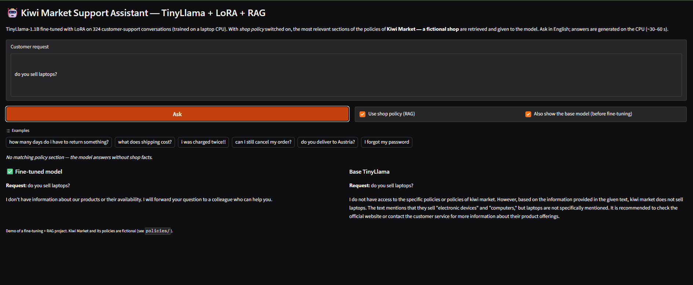
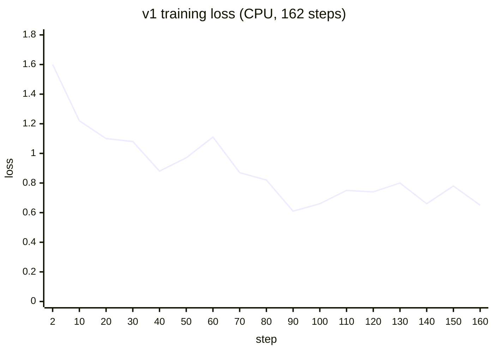

# 🤖 TinyLlama Customer-Support Assistant (LoRA fine-tuning + RAG on CPU)

[](https://github.com/Geektasilla/tinyllama-customer-support-lora/actions/workflows/tests.yml)


Fine-tuning a small open-source language model — **TinyLlama-1.1B-Chat** — to act as the support assistant of an
online shop, connecting it to the shop's policies with **retrieval (RAG)**, and **measuring** each step.

The whole pipeline runs on an ordinary laptop **without a GPU**: LoRA trains only 1.1 % of the weights.

> Why a small model? A company can run it on its own server: no per-request API costs, and customer data can stay
> on the company's own infrastructure — an important point under GDPR.

Two versions of the LoRA adapter:

| | Trained on | Training time (Intel i7 CPU) |
|---|---|---|
| **v1** | 324 support conversations (style only) | 56 min |
| **v2** | the same 324 conversations + 66 answers grounded in retrieved policy sections (×2) — RAG-aware fine-tuning in the style of RAFT | 102 min |



*Request "do you sell laptops?" — the shop policy does not cover the product range. v2 says so and forwards the
question; the base model, given the same context, claims "kiwi market does not sell laptops".*

## Results

### 1. Facts from the shop policy (RAG)

The shop **Kiwi Market** and its [policies](policies/) are fictional (7 Markdown files, 18 sections).
16 held-out customer questions ([eval_questions.json](policies/eval_questions.json)), none of them used in training;
every set-up gets the same two retrieved policy sections. An answer counts as correct if it contains the expected fact
(e.g. "30 days", "€4.90").

| Model (with retrieved policy) | Correct facts | Answers with placeholders `{{…}}` |
|---|---|---|
| Base TinyLlama | 11 / 16 (69 %) | 0 |
| v1 — trained on support style only | 2 / 16 (12 %) | 4 |
| **v2 — trained with retrieved policy in the prompt** | **15 / 16 (94 %)** | **0** |

Retrieval (BM25): the correct section is ranked first for 14 / 16 questions and is among the two sections given to
the model for 16 / 16.

The one miss of v2: *"can you deliver to Vienna Austria and how long does it take"* — price and free-shipping threshold
correct, delivery time "3–7 business days" instead of 4–7.
All answers: [results/rag_samples.md](results/rag_samples.md), numbers: [results/rag_metrics.json](results/rag_metrics.json).

**Why v2 was needed.** v1 was trained on dataset answers that ask for details and use placeholders such as
`{{Order Number}}`. With the policy in the prompt it kept doing exactly that and ignored the facts (12 %).
v2 was trained on examples where the retrieved sections are part of the prompt, including questions the policy
does not answer (→ "I will forward your question to a colleague") and cases where the answer is "no"
(an order placed 5 hours ago, a return after 40 days, delivery to Switzerland).

### 2. Manual test in the chat window

Five requests, each answer checked against the policy and saved as a screenshot —
**[protocol with all answers](docs/manual_tests/README.md)**.

| Set-up | ✅ correct | ⚠️ partly | ❌ wrong |
|---|---|---|---|
| v1 + RAG | 0 | 0 | 5 |
| **v2 + RAG** | **3** | **1** | **1** |
| base + RAG | 0 | 2 | 3 |

### 3. General support answers (no policy)

81 held-out requests from the support dataset (3 per intent, never seen in training), no policy in the prompt —
this checks that the policy training did not damage the general support behaviour:

| Metric | Base TinyLlama | v1 | v2 |
|---|---|---|---|
| Answer loss ↓ | 1.70 | 0.862 | **0.854** |
| Perplexity ↓ | 5.47 | 2.37 | **2.35** |
| ROUGE-L vs. reference answer ↑ | 0.189 | 0.303 | **0.305** |
| Answers that end on their own (no cut-off) | 75 % | **100 %** | 75 % |
| Average answer length | 157 words | 79 words | 99 words |
| Answers containing a placeholder such as `{{Order Number}}` | 25 % | 38 % | 38 % |

*Loss and perplexity: all 81 requests. Generation metrics: 8 requests from 8 different intents
(for v2, 2 of the 8 answers reached the 256-token limit).
Answers: [results/samples.md](results/samples.md) (v1), [results/samples_v2.md](results/samples_v2.md) (v2);
numbers: [results/metrics.json](results/metrics.json), [results/metrics_v2.json](results/metrics_v2.json).*

Validation loss: v1 **0.907 → 0.862**, v2 **0.890 → 0.854** (after epoch 1 → 2; base model: 1.70).



### Honest limitations

- **Comparing numbers:** to *"I ordered 3 hours ago, can I still cancel?"* v2 answers "Yes, you can", then states
  the correct 2-hour rule — a contradiction. The automatic evaluation does not catch this, because it only checks that
  the expected fact appears in the answer.
- v2 can still add details that are not in the policy (a support URL in the manual test).
- When retrieval ranks a wrong section first, the answer gets worse (manual test 4: *Payments — Charged twice*
  ranked above *Contact*).
- 16 evaluation questions and 5 manual requests are a small sample; the numbers show a direction, not a guarantee.
- 1.1 B parameters: for a real product a larger model and a larger, real policy base would be needed.
- ROUGE-L only measures word overlap with one reference answer; it is a rough indicator, not a quality score.

## What was done

**Data** ([`data.py`](src/supportlora/data.py), [`prepare_data.py`](src/supportlora/prepare_data.py))
- Dataset: [Bitext Customer Support](https://huggingface.co/datasets/bitext/Bitext-customer-support-llm-chatbot-training-dataset)
  (26,872 request/answer pairs, 27 intents, CDLA-Sharing-1.0). Requests contain realistic typos and slang.
- Normalisation (whitespace, broken encodings), de-duplication of questions.
- **Balanced, deterministic split:** 12 training + 3 test examples for each of the 27 intents; train and test never
  share a question.
- **Policy-grounded examples** ([`train_grounded.json`](policies/train_grounded.json)): 66 written question/answer pairs.
  Tests check that none of the evaluation questions leaked into them and that every number in an answer exists in the
  policy or in the question.

**Retrieval** ([`rag.py`](src/supportlora/rag.py))
- Policies split into sections by `##` headings; BM25 implemented in plain Python (no vector database needed for 18 sections).
- Stop words, simple stemming and a small synonym list (*parcel → package*, *Austria → EU*, *money back → refund*).
- A minimum score: off-topic questions get an explicit "no matching policy section" context instead of unrelated text.
- A separate system prompt for RAG: the v1 prompt said "use placeholders", which contradicts "take facts from the policy".

**Training** ([`train.py`](src/supportlora/train.py), [`features.py`](src/supportlora/features.py))
- TinyLlama's own **chat template** (system / user / assistant); for v2 the retrieved sections are part of the system prompt.
- **Loss only on the assistant answer** — the prompt tokens are masked.
- **Correct end-of-answer handling:** a separate padding token, so the end-of-sequence token is never masked.
  (In my first version padding used the EOS token, the collator masked every EOS, and the model never learned
  to stop — the evaluation now checks this explicitly.)
- LoRA r=16 on all attention and MLP projections, 2 epochs, cosine schedule, dynamic padding.

**Evaluation** ([`evaluate.py`](src/supportlora/evaluate.py), [`rag_eval.py`](src/supportlora/rag_eval.py),
[`metrics.py`](src/supportlora/metrics.py))
- All models on the same held-out requests, greedy decoding; both adapters loaded on one base model and switched.
- Retrieval hit rate, fact accuracy, placeholder count; loss / perplexity, ROUGE-L (own implementation, unit-tested),
  stop behaviour, answer length.
- Manual test protocol with screenshots.

## Run it

```bash
pip install -e ".[train,dev]"

python -m supportlora.prepare_data     # download the dataset, build data/train.csv and data/test.csv
python -m supportlora.train --max-steps 2 --output adapter_smoke   # smoke test
python -m supportlora.train            # v1 (~1 h on CPU, a few minutes on a GPU)
python -m supportlora.train --grounded policies/train_grounded.json --output adapter_rag   # v2 (~1.7 h on CPU)
python -m supportlora.evaluate --adapter adapter_rag --tag v2   # base vs v2 on the support test set
python -m supportlora.rag_eval         # base vs v1 vs v2 with retrieved policy
python -m supportlora.chat             # terminal chat with the shop policy (--no-policy, --base)

pip install -e ".[app]"
python -m supportlora.app              # chat window in the browser, fine-tuned vs base side by side
```

The repository also contains ready-made **PyCharm run configurations** (`.run/`) for every step.

## Tests

```bash
pytest
```

45 unit tests that run without downloading any model: text normalisation and encoding repair, balanced split
without leakage, prompt masking, the end-of-answer token, padding, ROUGE-L, policy splitting, tokenisation and
synonyms, retrieval quality on the held-out questions, the RAG prompt, and quality gates for the policy-grounded
training data. They run in GitHub Actions on every push.

## Project structure

```
policies/            # fictional shop policy (Markdown), evaluation questions, policy-grounded training examples
src/supportlora/
├── data.py          # cleaning, balanced split, chat messages, system prompts
├── features.py      # prompt masking, EOS handling, padding (pure functions, unit-tested)
├── metrics.py       # ROUGE-L
├── modeling.py      # tokenizer / model loading, encoding
├── rag.py           # policy sections, BM25 retrieval, context building
├── prepare_data.py  # dataset download and subset
├── train.py         # LoRA training (v1, and v2 with --grounded)
├── evaluate.py      # base vs fine-tuned on the support test set
├── rag_eval.py      # base vs v1 vs v2 with retrieved policy
├── chat.py          # chat in the terminal
└── app.py           # chat window in the browser (Gradio), streaming, base vs fine-tuned
results/             # metrics, sample answers, training logs
docs/manual_tests/   # manual test protocol and screenshots
tests/
```

## Background

This project started as a course exercise on a mental-health FAQ dataset. Training on a laptop CPU stopped after
5 steps, and reviewing the code revealed the end-of-answer bug described above. I rebuilt it as a reusable pipeline
and switched to a customer-support dataset. A manual test of v1 with the shop policy showed that it ignored the
retrieved facts, which led to the policy-grounded training of v2.
