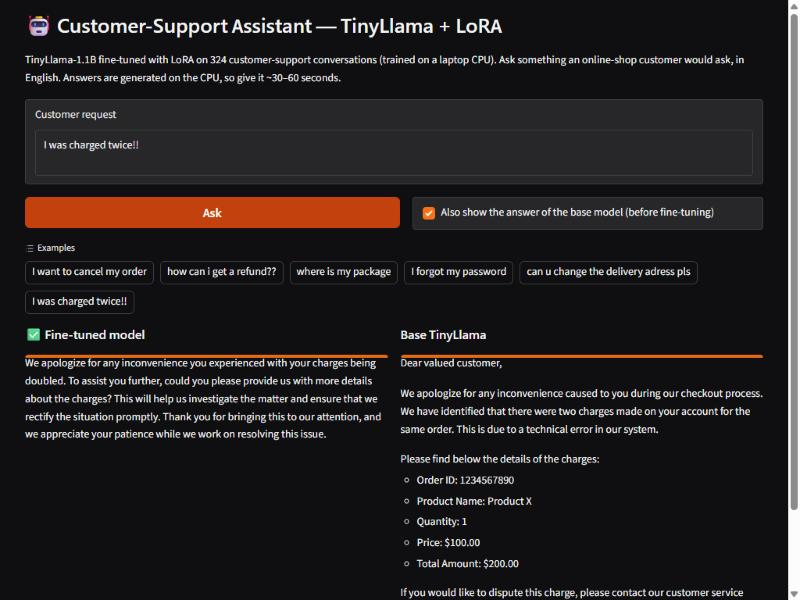
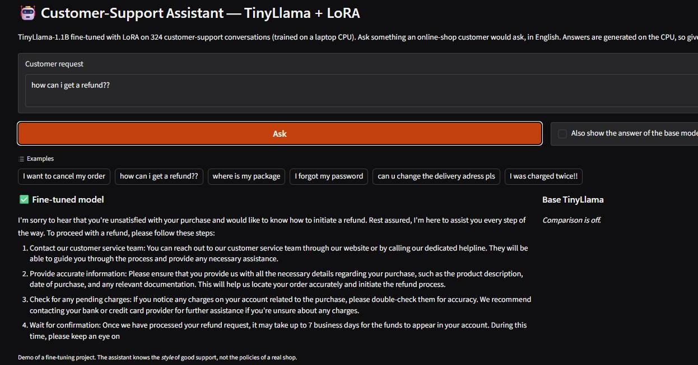
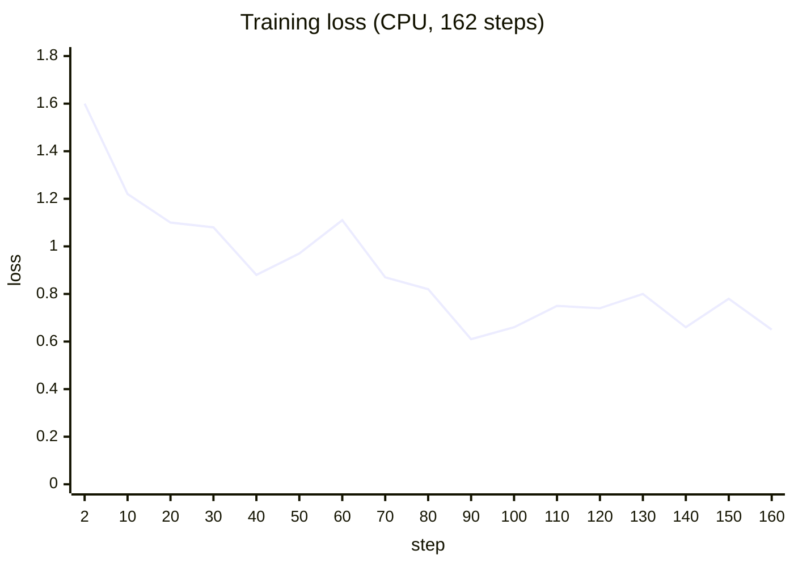

# 🤖 TinyLlama Customer-Support Assistant (LoRA fine-tuning on CPU)

[](https://github.com/Geektasilla/tinyllama-customer-support-lora/actions/workflows/tests.yml)


Fine-tuning a small open-source language model — **TinyLlama-1.1B-Chat** — to act as an online-shop support assistant,
and **measuring** whether it actually got better.

The whole pipeline runs on an ordinary laptop **without a GPU**: LoRA trains only 1.1 % of the weights,
so 2 epochs on 324 examples took **56 minutes on an Intel i7 CPU**.

> Why a small model? A company can run it on its own server: no per-request API costs, and customer data can stay
> on the company's own infrastructure — an important point under GDPR. The same pipeline works for any FAQ / support dataset.



*Local chat window (`python -m supportlora.app`). Request: "I was charged twice!!" — the **base model invents an
order ID, a product and a total of $200** and admits a "technical error"; in this answer the **fine-tuned model names no order data**
and asks the customer for the details.*



*A request with typos — "how can i get a refund??" — answered step by step in the tone of a support agent.*

## Results

Evaluated on **81 held-out requests** (3 per intent, never seen in training):

| Metric | Base TinyLlama | Fine-tuned (LoRA) |
|---|---|---|
| Answer loss ↓ | 1.70 | **0.86** |
| Perplexity ↓ | 5.47 | **2.37** |
| ROUGE-L vs. reference answer ↑ | 0.19 | **0.30** |
| Answers that end on their own (no cut-off) ↑ | 75 % | **100 %** |
| Average answer length | 157 words | **79 words** |
| Answers containing a placeholder such as `{{Order Number}}` ↑ | 25 % | **38 %** |

*Loss and perplexity: all 81 test requests. Generation metrics: 8 requests from 8 different intents.
Full answers side by side: [results/samples.md](results/samples.md), raw numbers: [results/metrics.json](results/metrics.json).*



Validation loss: **0.907** after epoch 1 → **0.862** after epoch 2 (base model: 1.70).

### What changed in the answers

**Request:** *"can you help me check the early exit penalties?"*

| Base TinyLlama | Fine-tuned |
|---|---|
| *"Navigate to the "Pricing" section of your account. Look for the "Early Exit Penalty" option under the "Shipping & Handling" tab…"* — **invents a UI that does not exist** | *"To provide you with accurate information, could you please provide me with your account details such as your account number or username?"* — **asks for the data it needs instead of guessing** |

**Request:** *"I don't know what I have to do to look for my invoice #12588"*
→ the fine-tuned model replaced the number with the placeholder `{{Invoice Number}}`, as the reference answers in
the dataset do. (Measured over 8 test requests, placeholders appear in 38 % of fine-tuned answers vs. 25 % for the base model.)

**Request:** *"I need help seeing your reimbursement policy"*
→ the base model writes *"here's a reimbursement policy for your online shop"* (it confuses its role and talks to the
shop owner); the fine-tuned model answers as the shop's support agent.

### Honest limitations

- 1.1 B parameters and 324 training examples: the model still sometimes misreads a request
  (e.g. *"list the payment methods"* is answered as if the customer were the shop).
- Answers are generic — the model knows the *style* of good support, not the facts of a real shop
  (e.g. it may say a refund takes "up to 7 business days" because such phrases are common in the dataset).
  For a real product this would be combined with retrieval (RAG) over the shop's actual policies — planned as the next step.
- ROUGE-L only measures word overlap with one reference answer; it is a rough indicator, not a quality score.

## What was done

**Data** ([`data.py`](src/supportlora/data.py), [`prepare_data.py`](src/supportlora/prepare_data.py))
- Dataset: [Bitext Customer Support](https://huggingface.co/datasets/bitext/Bitext-customer-support-llm-chatbot-training-dataset)
  (26,872 request/answer pairs, 27 intents, CDLA-Sharing-1.0). Requests contain realistic typos and slang.
- Normalisation (whitespace, broken encodings), de-duplication of questions.
- **Balanced, deterministic split:** 12 training + 3 test examples for each of the 27 intents; train and test never
  share a question.

**Training** ([`train.py`](src/supportlora/train.py), [`features.py`](src/supportlora/features.py))
- TinyLlama's own **chat template** (system / user / assistant).
- **Loss only on the assistant answer** — the prompt tokens are masked.
- **Correct end-of-answer handling:** a separate padding token, so the end-of-sequence token is never masked.
  (In my first version padding used the EOS token, the collator masked every EOS, and the model never learned
  to stop — the evaluation now checks this explicitly.)
- LoRA r=16 on all attention and MLP projections, 2 epochs, cosine schedule, dynamic padding.

**Evaluation** ([`evaluate.py`](src/supportlora/evaluate.py), [`metrics.py`](src/supportlora/metrics.py))
- Base model and fine-tuned adapter on the same held-out requests, greedy decoding.
- Loss / perplexity on the answer tokens, ROUGE-L (own implementation, unit-tested), stop behaviour,
  answer length, placeholder usage.

## Run it

```bash
pip install -e ".[train,dev]"

python -m supportlora.prepare_data     # download the dataset, build data/train.csv and data/test.csv
python -m supportlora.train --max-steps 2 --output adapter_smoke   # 1-minute smoke test
python -m supportlora.train            # full training (~1 h on CPU, a few minutes on a GPU)
python -m supportlora.evaluate         # base vs fine-tuned -> results/
python -m supportlora.chat             # talk to the fine-tuned model in the terminal (add --base for the original)

pip install -e ".[app]"
python -m supportlora.app              # chat window in the browser, fine-tuned vs base side by side
```

The repository also contains ready-made **PyCharm run configurations** (`.run/`) for every step.

## Tests

```bash
pytest
```

26 unit tests for the parts that decide whether training is correct, without downloading any model:
text normalisation and encoding repair, balanced split without leakage, prompt masking, the end-of-answer token,
padding, and the ROUGE-L implementation. They run in GitHub Actions on every push.

## Project structure

```
src/supportlora/
├── data.py          # cleaning, balanced split, chat messages
├── features.py      # prompt masking, EOS handling, padding (pure functions, unit-tested)
├── metrics.py       # ROUGE-L
├── modeling.py      # tokenizer / model loading, encoding
├── prepare_data.py  # dataset download and subset
├── train.py         # LoRA training
├── evaluate.py      # base vs fine-tuned comparison
├── chat.py          # chat in the terminal
└── app.py           # chat window in the browser (Gradio), streaming, base vs fine-tuned
results/             # metrics.json, samples.md, training_log.json
tests/
```

## Background

This project started as a course exercise on a mental-health FAQ dataset. Training on a laptop CPU stopped after
5 steps, and reviewing the code revealed the end-of-answer bug described above. I rebuilt it as a reusable pipeline
and switched to a customer-support dataset — a realistic business use case for small, self-hosted models.
